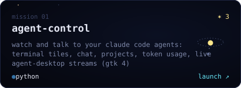
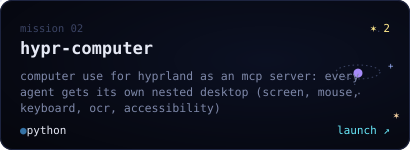

<!--
            .        *          .               .
      *          you found the source.     ✶
                  hi, fellow explorer.            .
        .                                  *
                       /\
                      /  \        every image below is plain text:
          .          |    |       ascii characters, drawn into svgs
                     | () |       by scripts/build.py, refreshed daily.
             *       |    |
                    /|    |\           .
                   / |    | \                  *
                  /__|____|__\
                     ||  ||       .
          .          /\  /\
                    '  ''  '              .
-->

  

  

  

  
  

how this profile works

 

- **No screenshots, no GIFs.** Everything above is monospace text drawn into hand-written SVGs.
- **The planet** is ray-traced into ascii: sphere and ring intersections, diffuse light, the ring's shadow, and a storm that rotates across 24 frames.
- **The sky** is my contribution graph. Each star is a day in the last year, and the dashed line joins my busiest days.
- **The moon** is tonight's real phase over Zürich, recomputed every morning.
- **A GitHub Action** runs [`scripts/build.py`](scripts/build.py) daily. It uses only the Python standard library and the GraphQL API, with [JetBrains Mono](https://github.com/JetBrains/JetBrainsMono) (OFL) subset and embedded so the ascii lines up everywhere.

  

